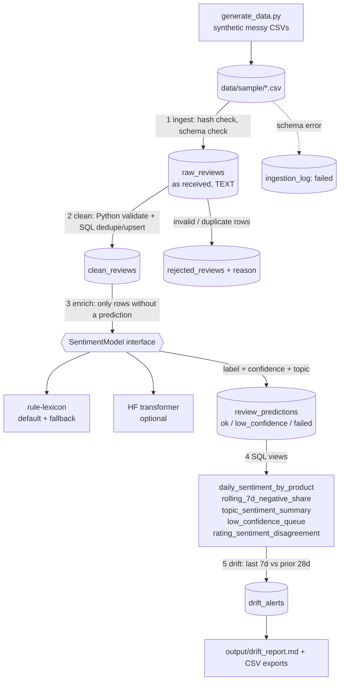

# Architecture and data flow



Plain-text version

```
CSV batches --ingest--> RAW --clean--> CLEAN (+ REJECTED) --enrich(AI)--> PREDICTIONS
                                                                              |
                                              SQL views (aggregates) <--------+
                                                    |
                                              drift checks --> drift_alerts --> report
```

| Layer | Table | Purpose |
|---|---|---|
| Raw | `raw_reviews`, `ingestion_log` | Exact copy of input plus batch id; lets us replay cleaning |
| Clean | `clean_reviews`, `rejected_reviews` | Typed, deduplicated data; every dropped row keeps a reason |
| Curated | `review_predictions` | Sentiment, confidence, topic, model name/version, status |
| Serving | SQL views | Aggregates for dashboards |
| Monitoring | `drift_alerts` | Output of drift checks |

Incrementality is driven by state, not by timestamps: `raw_reviews.cleaned_at IS NULL` selects rows to clean,
and `LEFT JOIN review_predictions ... IS NULL` selects reviews to score.
